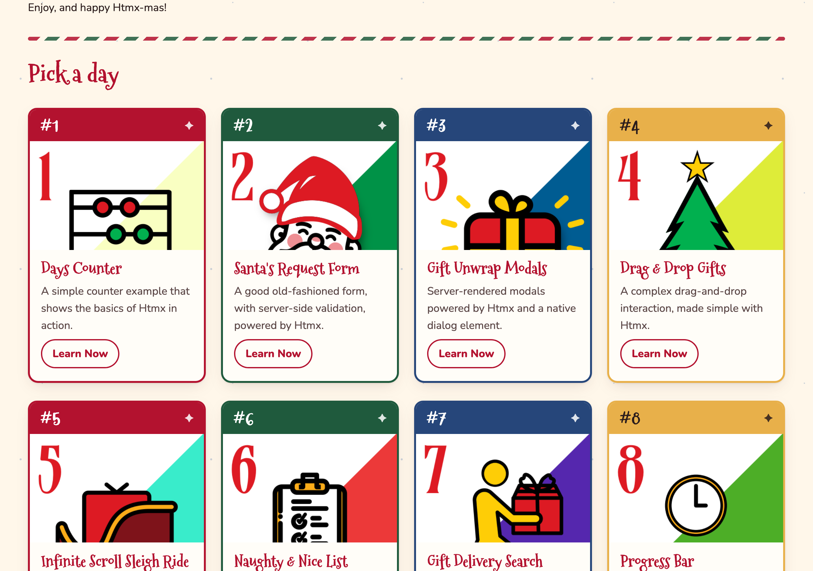
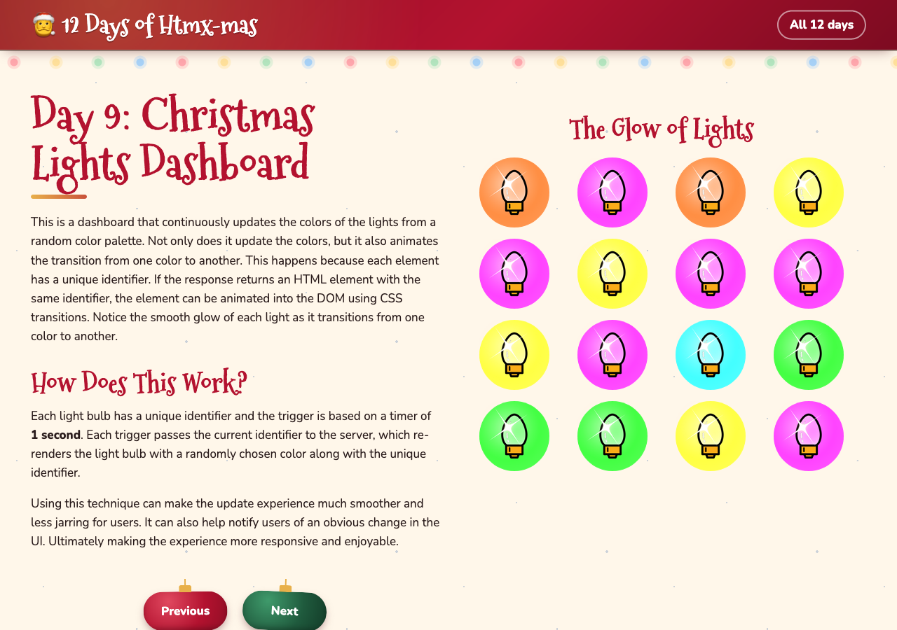

This is a Christmas themed ASP.NET Core application with 12 demos showing
how developers can leverage Htmx in their web solutions. These are 12 common
patterns you may apply to your existing applications that can improve the
user experience with only minor changes to your backend code.

Htmx is a "no-build" solution, so you won't need complex JavaScript toolchains or
to adopt any new framework just to add some new functionality to existing applications.

Give it a try!

The project now runs on **htmx 4 (4.0.1)** with the **Htmx.Net 2.0 preview**
(`Htmx` / `Htmx.TagHelpers` 2.0.0-preview.1) on **.NET 10**. It also has a refreshed,
whimsical Christmas design: advent-style day cards, gentle snowfall, dark mode, and
reduced-motion friendly animations. All styling is hand-rolled CSS, with no Bootstrap or jQuery.





*Day 9: the Christmas Lights Dashboard, updating live with htmx.*

## Getting Started

You will need [.NET 10 SDK](https://dot.net) and an IDE like [JetBrains Rider](https://jetbrains.com/rider). That's it!

### Running locally

```bash
dotnet run --launch-profile http
```

Then open <http://localhost:5282>.

### The 12 days

1. Counter
2. Santa's Request Form
3. Gift Unwrap Modals
4. Drag & Drop Gifts
5. Infinite Scroll Sleigh Ride
6. Naughty & Nice List
7. Gift Delivery Search
8. Progress Bar
9. Christmas Lights Dashboard
10. Out of Band Swaps (sweater)
11. Are You Sure About That? (confirm)
12. Keyboard Shortcuts

## Acknowledgments

Many of the initial art elements are adapted from [The Noun Project](https://thenounproject.org) which I am
a member. While the code is provided under MIT, I'm not sure about the images themselves as I cannot extend
their licensing to you.
